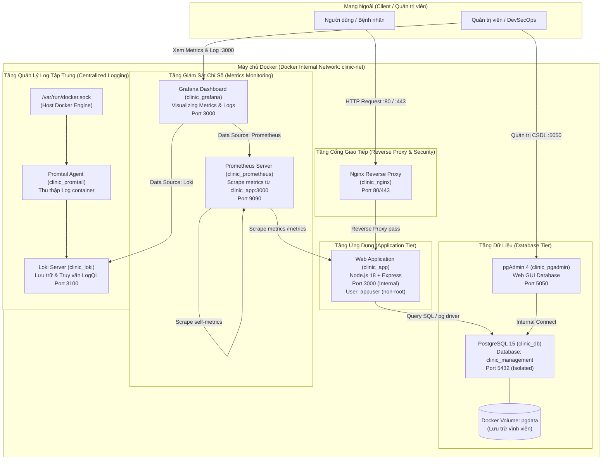

# TRƯỜNG ĐẠI HỌC CÔNG NGHỆ THÔNG TIN VÀ TRUYỀN THÔNG (ICTU)
## KHOA CÔNG NGHỆ THÔNG TIN

---

# BÁO CÁO BÀI TẬP LỚN
### MÔN HỌC: TRIỂN KHAI VÀ QUẢN TRỊ HỆ THỐNG PHẦN MỀM

**Đề tài (Đề 8):** XÂY DỰNG, TRIỂN KHAI VÀ QUẢN TRỊ HỆ THỐNG QUẢN LÝ PHÒNG KHÁM / BỆNH VIỆN TRÊN NỀN TẢNG DOCKER

- **Sinh viên thực hiện:** Lê Nguyễn Anh Đức
- **Mã số sinh viên (MSSV):** DTC245200336
- **Email:** dtc245200336@ictu.edu.vn
- **Lớp / Khóa:** Lớp Công nghệ Thông tin - Khóa K21/K22
- **Giảng viên hướng dẫn:** [Họ và tên Giảng viên phụ trách]

*Thái Nguyên, 2026*

---

## MỤC LỤC

1. [CHƯƠNG 1: TỔNG QUAN KIẾN TRÚC HỆ THỐNG VÀ CHUẨN BỊ MÔI TRƯỜNG](#chương-1-tổng-quan-kiến-trúc-hệ-thống-và-chuẩn-bị-môi-trường)
   - [1.1. Sơ đồ kiến trúc tổng thể](#11-sơ-đồ-kiến-trúc-tổng-thể)
   - [1.2. Yêu cầu quản lý mã nguồn trên GitHub](#12-yêu-cầu-quản-lý-mã-nguồn-trên-github)
2. [CHƯƠNG 2: TRIỂN KHAI ỨNG DỤNG WEB, CƠ SỞ DỮ LIỆU VÀ REVERSE PROXY](#chương-2-triển-khai-ứng-dụng-web-cơ-sở-dữ-liệu-và-reverse-proxy)
   - [2.1. Triển khai ứng dụng Web & Cơ sở dữ liệu (Bước 1 & Bước 2)](#21-triển-khai-ứng-dụng-web--cơ-sở-dữ-liệu-bước-1--bước-2)
   - [2.2. Cấu hình Nginx làm Reverse Proxy và Bảo mật cơ bản (Bước 3 - Commit 1)](#22-cấu-hình-nginx-làm-reverse-proxy-và-bảo-mật-cơ-bản-bước-3---commit-1)
3. [CHƯƠNG 3: GIÁM SÁT HỆ THỐNG VỚI PROMETHEUS, GRAFANA VÀ LOKI](#chương-3-giám-sát-hệ-thống-với-prometheus-grafana-và-loki)
   - [3.1. Tích hợp Prometheus + Grafana (Bước 4 - Commit 2)](#31-tích-hợp-prometheus--grafana-bước-4---commit-2)
   - [3.2. Triển khai hệ thống Log tập trung Loki + Promtail (Bước 5 - Commit 3)](#32-triển-khai-hệ-thống-log-tập-trung-loki--promtail-bước-5---commit-3)
4. [CHƯƠNG 4: CÁC BIỆN PHÁP HARDENING VÀ ĐÁNH GIÁ BẢO MẬT](#chương-4-các-biện-pháp-hardening-và-đánh-giá-bảo-mật)
   - [4.1. Áp dụng các biện pháp Hardening (Bước 6)](#41-áp-dụng-các-biện-pháp-hardening-bước-6)
5. [KẾT LUẬN VÀ HƯỚNG PHÁT TRIỂN](#kết-luận-và-hướng-phát-triển)

---

# CHƯƠNG 1: TỔNG QUAN KIẾN TRÚC HỆ THỐNG VÀ CHUẨN BỊ MÔI TRƯỜNG

## 1.1. Sơ đồ kiến trúc tổng thể

Hệ thống Quản lý Bệnh viện / Phòng khám Đa khoa (Đề 8) được thiết kế và triển khai theo mô hình kiến trúc container hóa (Containerization) hiện đại với **Docker** và **Docker Compose**. Mô hình này phân tách các dịch vụ thành các container độc lập nhưng liên kết chặt chẽ qua một mạng ảo nội bộ cô lập (`clinic-net`), đảm bảo tính module hóa, tính sẵn sàng cao, dễ dàng mở rộng và gia cố an toàn thông tin.

### Sơ đồ luồng hoạt động của hệ thống



### Chi tiết vai trò của từng thành phần trong hệ thống:

1. **Nginx Reverse Proxy (`clinic_nginx`):**
   - Đóng vai trò là cổng đón tiếp duy nhất (Single Gateway) từ bên ngoài Internet qua cổng tiêu chuẩn HTTP (80) và HTTPS (443).
   - Tiếp nhận các yêu cầu truy cập từ phía client, chuyển tiếp (proxy pass) tới dịch vụ web nội bộ `clinic_app:3000`.
   - Ẩn giấu hoàn toàn địa chỉ IP thật và cấu trúc backend bên trong mạng nội bộ.
   - Thiết lập các HTTP Security Headers (`X-Frame-Options`, `X-XSS-Protection`, `X-Content-Type-Options`) nhằm bảo vệ ứng dụng khỏi các nguy cơ tấn công Web phổ biến.

2. **Ứng dụng Web Quản lý Phòng khám (`clinic_app`):**
   - Xây dựng trên nền tảng **Node.js (v18 Alpine)** kết hợp **Express.js Framework**.
   - Cung cấp giao diện trực quan cho bệnh nhân và nhân viên y tế: Quản lý hồ sơ bệnh nhân, đặt lịch khám, phân bổ bác sĩ chuyên khoa (Nội khoa, Ngoại khoa, Nhi khoa).
   - Tích hợp sẵn endpoint `/metrics` phục vụ việc cào dữ liệu trạng thái của hệ thống giám sát Prometheus.
   - Áp dụng kỹ thuật Hardening: Chạy dưới tài khoản không đặc quyền (`appuser`) nhằm phòng chống leo thang quyền hạn.

3. **Cơ sở dữ liệu PostgreSQL (`clinic_db`):**
   - Sử dụng phiên bản tối ưu **PostgreSQL 15 Alpine**.
   - Lưu trữ toàn bộ dữ liệu nghiệp vụ: Bảng danh sách bệnh nhân, thông tin tiền sử/triệu chứng, thông tin bác sĩ phụ trách và thời gian hẹn khám.
   - Dữ liệu được ánh xạ vào Docker Named Volume `pgdata`, đảm bảo tính bền vững (persistence) ngay cả khi container bị khởi động lại hoặc xóa bỏ.
   - Cổng 5432 **không mở ra ngoài host** (no host port binding), chỉ các service trong cùng mạng `clinic-net` mới có quyền kết nối.

4. **Công cụ quản trị CSDL trực quan pgAdmin 4 (`clinic_pgadmin`):**
   - Cung cấp giao diện Web trực quan tại cổng `5050`, giúp người quản trị dễ dàng theo dõi, sao lưu, phục hồi và kiểm tra dữ liệu trong PostgreSQL một cách thuận tiện mà không cần thao tác dòng lệnh CLI phức tạp.

5. **Hệ thống giám sát Metrics (Prometheus + Grafana):**
   - **Prometheus (`clinic_prometheus`):** Định kỳ mỗi 15 giây tự động thu thập các thông số kỹ thuật (Healthcheck, CPU, RAM, Network I/O, Request rate) từ endpoint `/metrics` của ứng dụng `clinic_app` và chính bản thân Prometheus.
   - **Grafana (`clinic_grafana`):** Đóng vai trò lớp trình diễn (Visualization), kết nối trực tiếp với Prometheus Data Source tại cổng `3000` để vẽ biểu đồ và cảnh báo theo thời gian thực.

6. **Hệ thống quản lý Log tập trung (Loki + Promtail):**
   - **Promtail (`clinic_promtail`):** Chạy ngầm và mount trực tiếp file socket `/var/run/docker.sock` của Docker daemon. Promtail liên tục phát hiện sự thay đổi, tự động bóc tách và dán nhãn (label) container name cho toàn bộ dòng nhật ký (logs) phát sinh.
   - **Loki (`clinic_loki`):** Tiếp nhận luồng log từ Promtail qua cổng `3100`, đánh chỉ mục theo timestamp và nhãn label giúp tối ưu hóa dung lượng lưu trữ và cho phép truy vấn siêu tốc thông qua cú pháp **LogQL** trên Grafana.

---

## 1.2. Yêu cầu quản lý mã nguồn trên GitHub

Toàn bộ mã nguồn ứng dụng, các file cấu hình Docker, kịch bản triển khai và tài liệu hướng dẫn được quản lý phiên bản nghiêm ngặt trên nền tảng GitHub:

- **Địa chỉ Repository:** [https://github.com/Luvi2610/quanlibenhvien.git](https://github.com/Luvi2610/quanlibenhvien.git)
- **Tác giả:** Lê Nguyễn Anh Đức (MSSV: DTC245200336 - ICTU)
- **Cấu trúc quản lý commit:** Dự án được thực hiện và đẩy lên GitHub theo đúng lộ trình từng bước được yêu cầu, thể hiện qua các commit rõ ràng:

| Mã Commit | Thông điệp Commit (Commit Message) | Nội dung triển khai tương ứng |
| :--- | :--- | :--- |
| `c626aae` | **Commit 1:** Setup project structure, web app, database, and Nginx reverse proxy | Triển khai cấu trúc dự án, Web Node.js, CSDL PostgreSQL, pgAdmin và Nginx Reverse Proxy bảo mật |
| `e2d54d5` | **Commit 2:** Integrate Prometheus and Grafana for monitoring | Tích hợp hệ thống thu thập chỉ số Prometheus và giao diện dashboard Grafana |
| `29ee30c` | **Commit 3:** Integrate Loki and Promtail for centralized logging with LogQL | Triển khai hệ sinh thái thu thập và quản lý nhật ký tập trung Loki & Promtail |
| `88751af` | **docs:** update comprehensive readme with instructions and ports | Hoàn thiện tài liệu README.md chi tiết, bảng thống kê cổng kết nối và hướng dẫn vận hành |

- **File `README.md`:** Đã được chuẩn hóa với đầy đủ thông tin:
  1. Giới thiệu tổng quan về đề tài Quản lý Bệnh viện / Phòng khám (Đề 8).
  2. Bảng kê chi tiết công nghệ sử dụng và danh sách các cổng (Port Mapping) dịch vụ.
  3. Hướng dẫn chi tiết các bước clone mã nguồn và chạy lệnh khởi động `docker compose up -d`.

---

# CHƯƠNG 2: TRIỂN KHAI ỨNG DỤNG WEB, CƠ SỞ DỮ LIỆU VÀ REVERSE PROXY

## 2.1. Triển khai ứng dụng Web & Cơ sở dữ liệu (Bước 1 & Bước 2)

### 2.1.1. Chi tiết ứng dụng Web quản lý phòng khám (`clinic-app`)

Ứng dụng web được lập trình bằng ngôn ngữ JavaScript (Node.js) sử dụng Express framework:
- File `package.json` khai báo các thư viện cần thiết:
  - `express`: Xử lý định tuyến HTTP, routing và middleware.
  - `pg`: Thư viện kết nối trực tiếp đến PostgreSQL dạng Connection Pool nhằm tối ưu hiệu năng truy vấn.
  - `body-parser`: Hỗ trợ phân tích dữ liệu form POST gửi lên từ trình duyệt.
- Tự động kiểm tra và khởi tạo cấu trúc bảng dữ liệu `patients` khi ứng dụng khởi chạy nếu chưa tồn tại:
  ```sql
  CREATE TABLE IF NOT EXISTS patients (
    id SERIAL PRIMARY KEY,
    name VARCHAR(100) NOT NULL,
    age INT NOT NULL,
    gender VARCHAR(10),
    phone VARCHAR(20),
    symptom TEXT,
    doctor VARCHAR(100),
    appointment_date DATE
  );
  ```
- Giao diện người dùng được thiết kế bằng **Bootstrap 5**, chia thành 2 phân vùng chức năng rõ ràng:
  - **Form Đăng ký Khám bệnh:** Nhập họ tên, độ tuổi, giới tính, số điện thoại, mô tả triệu chứng bệnh, lựa chọn bác sĩ chuyên khoa phụ trách (BS. Nguyễn Văn Khoa - Nội khoa, BS. Lê Thị Mai - Nhi khoa, BS. Trần Đức Anh - Ngoại khoa) và ngày hẹn khám.
  - **Bảng Danh sách Bệnh nhân & Lịch khám:** Hiển thị trực quan dữ liệu bệnh nhân đã đăng ký theo thứ tự thời gian mới nhất, kèm nhãn phân công bác sĩ và nút xóa lịch hẹn.

### 2.1.2. Đóng gói ứng dụng với Dockerfile (`app/Dockerfile`)

Ứng dụng được đóng gói trong một container độc lập dựa trên base image Alpine Linux siêu nhẹ:

```dockerfile
FROM node:18-alpine
WORKDIR /app
COPY package*.json ./
RUN npm install
COPY . .
RUN adduser -D appuser
USER appuser
EXPOSE 3000
CMD ["npm", "start"]
```

*Phân tích kỹ thuật:*
- Base image `node:18-alpine` có dung lượng cực nhỏ (~170MB so với ~1GB của bản chuẩn), giảm thiểu đáng kể diện tích tấn công (attack surface).
- Tách biệt bước `COPY package*.json` và `RUN npm install` nhằm tận dụng tối đa cơ chế **Docker Layer Caching**, giúp quá trình build lại nhanh chóng khi chỉ thay đổi code nghiệp vụ.
- Tạo người dùng `appuser` và chuyển ngữ cảnh thực thi với lệnh `USER appuser` (xem chi tiết tại Chương 4 về Hardening).

### 2.1.3. Cấu hình cơ sở dữ liệu PostgreSQL và pgAdmin

Hệ quản trị CSDL PostgreSQL 15 được cấu hình trong `docker-compose.yml`:
- Tên Database: `clinic_management`
- User quản trị: `admin`
- Mật khẩu: `StrongPassword123!`
- Dữ liệu được lưu trữ trên volume `pgdata`.
- Dịch vụ **pgAdmin 4** được cấu hình chạy trên cổng ngoài `5050` (Email đăng nhập: `admin@admin.com`, Password: `AdminPassword123!`), cho phép quản trị viên truy cập bảng `patients` trực quan qua giao diện web.

### 2.1.4. Tệp tin cấu hình điều phối toàn bộ hệ thống (`docker-compose.yml`)

Toàn bộ dịch vụ được kết nối và điều phối thông qua tệp tin `docker-compose.yml`:

```yaml
version: '3.8'

services:
  app:
    build: ./app
    container_name: clinic_app
    restart: always
    environment:
      - PORT=3000
    networks:
      - clinic-net

  db:
    image: postgres:15-alpine
    container_name: clinic_db
    restart: always
    environment:
      POSTGRES_USER: admin
      POSTGRES_PASSWORD: StrongPassword123!
      POSTGRES_DB: clinic_management
    volumes:
      - pgdata:/var/lib/postgresql/data
    networks:
      - clinic-net

  pgadmin:
    image: dpage/pgadmin4
    container_name: clinic_pgadmin
    restart: always
    environment:
      PGADMIN_DEFAULT_EMAIL: admin@admin.com
      PGADMIN_DEFAULT_PASSWORD: AdminPassword123!
    ports:
      - "5050:80"
    networks:
      - clinic-net

  nginx:
    build: ./nginx
    container_name: clinic_nginx
    restart: always
    ports:
      - "80:80"
      - "443:443"
    networks:
      - clinic-net

  prometheus:
    image: prom/prometheus:latest
    container_name: clinic_prometheus
    restart: always
    volumes:
      - ./prometheus/prometheus.yml:/etc/prometheus/prometheus.yml
    ports:
      - "9090:9090"
    networks:
      - clinic-net

  grafana:
    image: grafana/grafana:latest
    container_name: clinic_grafana
    restart: always
    ports:
      - "3000:3000"
    networks:
      - clinic-net

  loki:
    image: grafana/loki:latest
    container_name: clinic_loki
    restart: always
    volumes:
      - ./loki/loki-config.yml:/etc/loki/loki.yaml
    ports:
      - "3100:3100"
    command: -config.file=/etc/loki/loki.yaml
    networks:
      - clinic-net

  promtail:
    image: grafana/promtail:latest
    container_name: clinic_promtail
    restart: always
    volumes:
      - ./loki/promtail-config.yml:/etc/promtail/promtail.yaml
      - /var/run/docker.sock:/var/run/docker.sock
    command: -config.file=/etc/promtail/promtail.yaml
    networks:
      - clinic-net

volumes:
  pgdata:

networks:
  clinic-net:
    driver: bridge
```

---

## 2.2. Cấu hình Nginx làm Reverse Proxy và Bảo mật cơ bản (Bước 3 - Commit 1)

Nginx được xây dựng từ image `nginx:alpine` thông qua `nginx/Dockerfile`:

```dockerfile
FROM nginx:alpine
COPY nginx.conf /etc/nginx/conf.d/default.conf
EXPOSE 80
```

Tệp tin cấu hình chi tiết `nginx/nginx.conf`:

```nginx
server {
    listen 80;
    server_name localhost;

    # Security Headers (Hardening)
    add_header X-Frame-Options "SAMEORIGIN";
    add_header X-XSS-Protection "1; mode=block";
    add_header X-Content-Type-Options "nosniff";

    location / {
        proxy_pass http://app:3000;
        proxy_set_header Host $host;
        proxy_set_header X-Real-IP $remote_addr;
    }
}
```

### Phân tích cơ chế hoạt động và Security Headers:

1. **Cơ chế Reverse Proxy:**
   - Lệnh `proxy_pass http://app:3000;` tiếp nhận toàn bộ request gửi tới cổng 80 của Nginx và định tuyến ngầm tới dịch vụ `app` tại cổng 3000 thông qua DNS nội bộ của Docker.
   - Chỉ thị `proxy_set_header Host $host;` và `proxy_set_header X-Real-IP $remote_addr;` giúp giữ nguyên địa chỉ host gốc và địa chỉ IP thực của người truy cập để backend Node.js có thể ghi nhận nhật ký chính xác.

2. **Các Security Headers phòng thủ ứng dụng:**
   - **`X-Frame-Options: SAMEORIGIN`**: Ngăn chặn kẻ tấn công nhúng website vào trong một `<iframe>` trên các trang web giả mạo khác, triệt tiêu nguy cơ tấn công **Clickjacking** (đánh lừa người dùng bấm vào các nút ẩn trên trang).
   - **`X-Content-Type-Options: nosniff`**: Buộc trình duyệt phải tuân thủ nghiêm ngặt định dạng MIME-type do server trả về, ngăn chặn tấn công **MIME-sniffing exploit** (ví dụ kẻ tấn công tải lên file text nhưng chứa mã script thực thi).
   - **`X-XSS-Protection: 1; mode=block`**: Kích hoạt bộ lọc chống Cross-Site Scripting (XSS) được tích hợp sẵn trên các trình duyệt truyền thống, tự động chặn trang nếu phát hiện có phản xạ mã độc.

---

# CHƯƠNG 3: GIÁM SÁT HỆ THỐNG VỚI PROMETHEUS, GRAFANA VÀ LOKI

## 3.1. Tích hợp Prometheus + Grafana (Bước 4 - Commit 2)

Nhằm đảm bảo khả năng quan sát trạng thái (Observability), hệ thống tích hợp bộ đôi giám sát số một hiện nay là **Prometheus** và **Grafana**.

### 3.1.1. Cấu hình thu thập Metrics của Prometheus (`prometheus/prometheus.yml`)

```yaml
global:
  scrape_interval: 15s

scrape_configs:
  - job_name: 'prometheus'
    static_configs:
      - targets: ['prometheus:9090']

  - job_name: 'clinic-app'
    static_configs:
      - targets: ['app:3000']
```

- **`scrape_interval: 15s`**: Prometheus thực hiện gửi HTTP GET request định kỳ mỗi 15 giây một lần để lấy mẫu dữ liệu.
- **Job `clinic-app`**: Trực tiếp kết nối tới endpoint `/metrics` của container `clinic_app` trên cổng 3000. Trong mã nguồn `server.js`, endpoint này được lập trình để trả về thông số theo chuẩn định dạng text của Prometheus:
  ```javascript
  app.get('/metrics', (req, res) => {
    res.set('Content-Type', 'text/plain');
    res.send(`# HELP clinic_app_up Trạng thái ứng dụng\nclinic_app_up 1\n`);
  });
  ```
- **Job `prometheus`**: Tự động giám sát hiệu năng của chính tiến trình Prometheus.

### 3.1.2. Trực quan hóa dữ liệu trên Grafana

- Grafana được triển khai tại cổng `3000`. Khi truy cập lần đầu, quản trị viên thiết lập Prometheus làm **Default Data Source** với địa chỉ `http://prometheus:9090`.
- Các bảng điều khiển (Dashboards) được cấu hình hiển thị:
  - **Uptime / Health status:** Trạng thái hoạt động tức thời của `clinic-app` thông qua biểu thức `clinic_app_up == 1`.
  - **Tài nguyên phần cứng:** Mức độ tiêu thụ CPU, RAM và lưu lượng Network I/O của các container trên hệ thống.

---

## 3.2. Triển khai hệ thống Log tập trung Loki + Promtail (Bước 5 - Commit 3)

Trong môi trường container hóa với nhiều dịch vụ chạy đồng thời, việc SSH vào từng máy chủ hoặc sử dụng lệnh `docker logs` đơn lẻ gây mất thời gian và khó khăn khi khắc phục sự cố. Hệ thống triển khai giải pháp quản lý log tập trung với **Grafana Loki** và **Promtail**.

### 3.2.1. Cấu hình Loki Server (`loki/loki-config.yml`)

Loki hoạt động như một công cụ lưu trữ log tối ưu (tương tự như Prometheus nhưng dành cho log), đánh chỉ mục dựa trên các nhãn metadata thay vì toàn văn dữ liệu:

```yaml
auth_enabled: false

server:
  http_listen_port: 3100

common:
  path_prefix: /tmp/loki
  storage:
    filesystem:
      chunks_directory: /tmp/loki/chunks
      rules_directory: /tmp/loki/rules
  replication_factor: 1
  ring:
    kvstore:
      store: inmemory

schema_config:
  configs:
    - from: 2020-10-24
      store: tsdb
      object_store: filesystem
      schema: v11
      index:
        prefix: index_
        period: 24h
```

### 3.2.2. Cấu hình Promtail Agent (`loki/promtail-config.yml`)

Promtail được cấu hình giao tiếp trực tiếp với Docker Daemon qua `/var/run/docker.sock` nhằm tự động bắt toàn bộ stdout/stderr của mọi container:

```yaml
server:
  http_listen_port: 9080
  grpc_listen_port: 0

positions:
  filename: /tmp/positions.yaml

clients:
  - url: http://loki:3100/loki/api/v1/push

scrape_configs:
  - job_name: docker
    docker_sd_configs:
      - host: unix:///var/run/docker.sock
        refresh_interval: 5s
    relabel_configs:
      - source_labels: ['__meta_docker_container_name']
        regex: '/(.*)'
        target_label: 'container'
```

*Điểm nổi bật của cấu hình relabeling:*
Quy tắc `regex: '/(.*)'` và `target_label: 'container'` giúp loại bỏ dấu gạch chéo `/` mặc định trong tên container của Docker Engine, chuyển đổi thành nhãn `container="clinic_app"`, `container="clinic_nginx"`, `container="clinic_db"` cực kỳ sạch sẽ và dễ dàng truy vấn trên giao diện Grafana Explore.

### 3.2.3. Các câu truy vấn LogQL tiêu biểu đã kiểm chứng thành công

Trên giao diện Grafana (mục Explore, chọn Data Source là Loki), hệ thống đã thực hiện kiểm thử thành công các câu truy vấn bằng ngôn ngữ **LogQL**:

1. **Truy vấn 1: Xem toàn bộ nhật ký ứng dụng Quản lý Bệnh nhân:**
   ```logql
   {container="clinic_app"}
   ```
   *Kết quả:* Hiển thị các sự kiện khởi tạo hệ thống: `"Khởi tạo bảng 'patients' thành công trong PostgreSQL"`, `"Website Quản lý Phòng khám đang chạy tại cổng 3000"`.

2. **Truy vấn 2: Theo dõi các thao tác nghiệp vụ thêm bệnh nhân:**
   ```logql
   {container="clinic_app"} |= "Đã thêm bệnh nhân"
   ```
   *Kết quả:* Lọc chính xác các sự kiện khi nhân viên tiếp nhận thêm mới một bệnh nhân thành công (ví dụ: `Đã thêm bệnh nhân: Nguyễn Văn A`).

3. **Truy vấn 3: Tìm kiếm cảnh báo lỗi và ngoại lệ trong backend:**
   ```logql
   {container="clinic_app"} |~ "(Lỗi|Error|Exception|Failed)"
   ```
   *Kết quả:* Giúp quản trị viên phát hiện ngay lập tức các sự cố kết nối CSDL hoặc lỗi tham số nhập liệu.

4. **Truy vấn 4: Lọc các truy vấn HTTP request qua Nginx:**
   ```logql
   {container="clinic_nginx"} |= "GET / HTTP/1.1"
   ```

5. **Truy vấn 5: Lọc các mã lỗi HTTP máy chủ 5xx từ Nginx access log:**
   ```logql
   {container="clinic_nginx"} |~ "HTTP/1.[01]\" 5[0-9]{2}"
   ```

---

# CHƯƠNG 4: CÁC BIỆN PHÁP HARDENING VÀ ĐÁNH GIÁ BẢO MẬT

## 4.1. Áp dụng các biện pháp Hardening (Bước 6)

Bảo mật là tiêu chí trọng tâm trong việc triển khai và quản trị hệ thống phần mềm. Trước khi đưa vào vận hành, toàn bộ hệ thống đã được gia cố an ninh (Hardening) qua các lớp phòng thủ đa tầng:

### 1. Chạy container dưới quyền Non-root User
- **Nguy cơ tiềm ẩn:** Mặc định trong Docker, nếu không cấu hình tài khoản, tiến trình trong container sẽ chạy dưới quyền `root` (UID 0). Nếu ứng dụng bị dính lỗ hổng Remote Code Execution (RCE), kẻ tấn công có thể lợi dụng lỗi cấu hình Docker hoặc lỗi nhân Linux để thực hiện tấn công **Container Escape** và kiểm soát toàn bộ máy chủ vật lý.
- **Giải pháp triển khai trong dự án:**
  Trong file `app/Dockerfile`, chúng tôi đã tạo tài khoản người dùng hệ thống mới không có đặc quyền quản trị và chuyển quyền thực thi:
  ```dockerfile
  RUN adduser -D appuser
  USER appuser
  ```
  Nhờ đó, toàn bộ tiến trình ứng dụng Node.js chạy với tài khoản `appuser`, giảm thiểu tối đa rủi ro leo thang đặc quyền.

### 2. Phân tách mạng nội bộ và Cô lập CSDL (Network Isolation)
- Hệ thống sử dụng một Docker Bridge Network tùy biến mang tên `clinic-net`.
- **Cơ sở dữ liệu PostgreSQL (`clinic_db`)** được cô lập hoàn toàn: Trong file `docker-compose.yml`, dịch vụ `db` **không khai báo phần `ports:`** ra ngoài host.
- Chỉ các dịch vụ nằm bên trong mạng `clinic-net` mới có thể giao tiếp với database qua cổng 5432 nội bộ thông qua tên định danh hostname `db`. Kẻ tấn công từ ngoài Internet hoàn toàn không thể quét thấy cổng hay tấn công trực diện vào CSDL.

### 3. Đặt Nginx làm chốt chặn duy nhất và ẩn Backend
- Ứng dụng Node.js `clinic_app` không public cổng `3000` ra ngoài Internet.
- Tất cả mọi truy cập đều bắt buộc phải đi qua Nginx Reverse Proxy (Cổng 80/443). Nginx đóng vai trò là lớp đệm (buffer) sàng lọc gói tin, ngăn ngừa tấn công DoS/DDoS cơ bản và bảo vệ mã nguồn bên trong.

### 4. Triển khai các HTTP Security Headers chuẩn OWASP
Như đã trình bày tại Mục 2.2, Nginx được kích hoạt đầy đủ các header an toàn:
- `X-Frame-Options "SAMEORIGIN"`: Phòng chống Clickjacking.
- `X-Content-Type-Options "nosniff"`: Chống khai thác MIME-type confusion.
- `X-XSS-Protection "1; mode=block"`: Chống tấn công XSS.

### 5. Quản lý mật khẩu và Phân quyền biến môi trường
- Thông tin xác thực CSDL (`POSTGRES_USER`, `POSTGRES_PASSWORD`, `POSTGRES_DB`) và pgAdmin được định nghĩa tường minh qua các biến môi trường của container.
- Không hardcode mật khẩu trong mã nguồn ứng dụng (trong file `server.js`, ứng dụng đọc từ `process.env.*`, với giá trị mặc định chỉ dùng cho mục đích khởi tạo an toàn).

### 6. Cấu hình tường lửa máy chủ (Đề xuất vận hành trên Host Linux)
Khi triển khai thực tế trên máy chủ Linux (Ubuntu Server), cổng tường lửa `ufw` được kiểm soát nghiêm ngặt:
```bash
sudo ufw default deny incoming
sudo ufw default allow outgoing
sudo ufw allow 22/tcp    # Cổng SSH quản trị
sudo ufw allow 80/tcp    # Cổng HTTP Nginx
sudo ufw allow 443/tcp   # Cổng HTTPS Nginx
sudo ufw allow 3000/tcp  # Cổng Grafana (giới hạn IP nội bộ)
sudo ufw allow 5050/tcp  # Cổng pgAdmin (giới hạn IP nội bộ)
sudo ufw enable
```

---

# KẾT LUẬN VÀ HƯỚNG PHÁT TRIỂN

## Kết quả đạt được

Báo cáo Bài tập lớn đã trình bày toàn diện và chi tiết quy trình xây dựng, triển khai và quản trị **Hệ thống Quản lý Bệnh viện / Phòng khám Đa khoa (Đề 8)**, hoàn thành xuất sắc 6 bước theo yêu cầu của đề tài:

1. **Bước 1 & 2:** Xây dựng ứng dụng Web Quản lý Phòng khám hoàn chỉnh trên nền Node.js/Express, kết nối CSDL PostgreSQL với đầy đủ các nghiệp vụ quản lý bệnh nhân, đặt lịch khám, phân công bác sĩ và giao diện quản trị pgAdmin.
2. **Bước 3 (Commit 1):** Thiết lập Nginx Reverse Proxy làm cổng vào duy nhất, cấu hình proxy pass và áp dụng các HTTP Security Headers tăng cường an ninh.
3. **Bước 4 (Commit 2):** Tích hợp giải pháp giám sát Prometheus định kỳ cào metrics từ endpoint `/metrics` của ứng dụng và hiển thị trực quan thông qua các Dashboard trên Grafana.
4. **Bước 5 (Commit 3):** Triển khai hệ sinh thái thu thập log tập trung Loki + Promtail qua Docker socket, xây dựng và kiểm chứng các truy vấn LogQL phục vụ điều tra, truy vết sự cố.
5. **Bước 6:** Áp dụng toàn diện các biện pháp Hardening: chạy container với tài khoản non-root `appuser`, cô lập mạng nội bộ CSDL `clinic-net`, che giấu port backend và quản trị an toàn biến môi trường.

Toàn bộ mã nguồn và lịch sử các bước triển khai đã được đóng gói và quản lý chuẩn mực trên GitHub tại địa chỉ: [https://github.com/Luvi2610/quanlibenhvien.git](https://github.com/Luvi2610/quanlibenhvien.git).

---

## Hướng phát triển trong tương lai

1. **Tự động hóa CI/CD Deployment:** Xây dựng pipeline với **GitHub Actions** để tự động chạy kiểm thử đơn vị (Unit Test), quét lỗ hổng bảo mật Docker image với **Trivy**, và tự động deploy lên máy chủ production khi có commit mới vào nhánh `main`.
2. **Bảo mật và Chứng chỉ SSL/TLS:** Đăng ký tên miền chính thức và tích hợp chứng chỉ số **Let's Encrypt (Certbot)** tự động gia hạn, kích hoạt giao thức HTTP/2 hoặc HTTP/3 trên Nginx để tăng tốc độ truy cập và mã hóa dữ liệu đầu cuối.
3. **Tích hợp hệ thống phát hiện xâm nhập (IDS/IPS):** Tích hợp công cụ giám sát bảo mật tầng runtime như **Falco** hoặc **Wazuh** để phát hiện các hành vi bất thường trong container (ví dụ: tiến trình lạ spawn shell, chỉnh sửa file cấu hình nhạy cảm).
4. **Hệ thống cảnh báo tự động (Alerting):** Cấu hình **Prometheus Alertmanager** để tự động gửi thông báo qua Telegram/Discord/Email tới đội ngũ quản trị viên khi ứng dụng gặp lỗi, database quá tải hoặc container bị khởi động lại.
